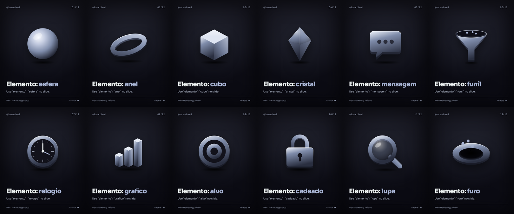

# Conteúdo do Well para advogados

Skill do Claude que gera **roteiros de vídeo, carrosséis e legendas** para o Instagram do Well ([@lunardiwell](https://instagram.com/lunardiwell)), voltado a advogados que trabalham no digital. Agora também monta **o carrossel pronto em PNG**, no padrão visual do perfil.

Lente de tudo: **"Do clique ao contrato."** Eu mostro onde o escritório perde cliente entre o anúncio e o contrato.

## Como funciona

1. Você pede: *"me dá a semana"*, *"carrossel sobre tempo de resposta"* ou *"roteiro sobre lead curioso"*.
2. A skill lê o posicionamento, a voz, as regras e o que já foi publicado.
3. Entrega pauta, gancho (3 opções), roteiro, copy do carrossel slide a slide e legenda.
4. Você aprova a copy.
5. Ela gera os slides em PNG (1080 x 1350) com a identidade escura e os elementos 3D.

## Estrutura (onde editar cada coisa)

```
skill/conteudo-well-advogados/      ← a skill (é isso que vira o arquivo .skill)
  SKILL.md                          processo, modo semana, carrossel pronto, checklist
  referencias/
    posicionamento-e-voz.md         quem é o Well, o furo, a voz, o público e as dores
    pilares-e-tom.md                os 4 pilares e o tom
    regras.md                       OAB, contrato com a Arven, fatos
    ganchos.md                      fórmulas de gancho
    formatos.md                     modelos de roteiro, carrossel e legenda
    identidade-visual.md            cores, fontes, elementos 3D
    banco-de-pautas.md              pautas prioritárias e banco geral
  marca.json                        cores, fontes, tamanhos, @ e rodapé (muda todos os slides)
  assets/foto-well.jpg              sua foto (coloque aqui, quadrada)
  templates/carrossel.html          layout dos slides e desenho dos elementos 3D
  scripts/renderizar.mjs            gera os PNGs a partir de um .json
  exemplos/                         carrossel modelo + catálogo dos elementos 3D
  biblioteca/publicados/            ficha de cada post publicado, com resultado
material-bruto/                     material cru (áudios, prints, referências). Não vai na skill
saida/                              carrosséis gerados
origem/                             a skill original, como veio
```

## Layouts e elementos

Layouts: `capa`, `ponto`, `lista`, `conversa` (cena de WhatsApp), `numero`, `final`.

Elementos 3D: `esfera`, `anel`, `cubo`, `cristal`, `mensagem`, `funil`, `relogio`, `grafico`, `alvo`, `cadeado`, `lupa`, `furo`.



Exemplo de carrossel completo: `skill/conteudo-well-advogados/exemplos/MODELO_LEAD_BARATO.json`.

## Gerando os slides

```bash
npm install                                         # uma vez (instala o Playwright)
node skill/conteudo-well-advogados/scripts/renderizar.mjs caminho/CARROSSEL.json
```

## Empacotando a skill para o Claude.ai

```bash
./empacotar.sh        # gera dist/conteudo-well-advogados.skill
```

Depois é só subir o arquivo em Configurações → Capacidades → Skills no Claude.ai.

## Cuidados

- **Repositório público.** Nada de nome de cliente, número real ou material interno da Arven aqui.
- Dado de mercado, regra ou número de plataforma vem marcado para conferir antes de postar.
